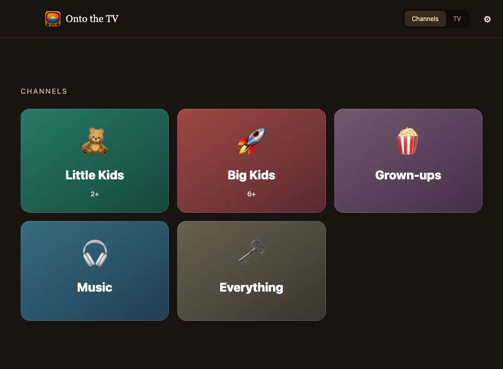

<p align="center"></p>

# Onto the TV

**A few channels, fed by the videos you already have.**

Open the app and the family-friendly channel starts. Changing who is watching
takes a further tap; grown-ups then pick a channel. Each channel draws its next
episode from your own library, learns from skips and completions, and avoids
recent repeats. Playback happens inside the app. **Onto the TV** hands that
channel to a Samsung on the same network. The app prepares one next episode for
the TV's native Next control, follows confirmed TV track changes, and learns
from remote skips as well as app skips. TVs without native queue support still
advance when an episode finishes. Adult items with a saved position use the
software transition so they resume correctly.



The TV tab opens individual files on the TV. Opening or dropping another file
saves your place and replaces the current video; **Add to queue** leaves it
playing. **History** lists the latest 500 files watched in the app or on the TV,
with the last watched time, progress, completion and a button to resume on the TV.
When it is full, files without scene bookmarks are dropped first.
History starts recording with this version; existing channel taste/bookmarks stay
separate. The Mac stays awake and on the same network while it serves the TV.

**Library** is a visual browser: Continue watching, film tiles, search and show
filters. Click a tile to play or resume on the TV. Artwork comes from local video
frames and is cached privately; browsing does not start playback. Add more video
folders through Library settings. These additions are for browsing and do not
change the children's channel groups.

## Watch from the TV instead

A Mac that stays on (for example a spare one with a media drive) can serve the library to
the TV, which then browses and plays with its own remote: channels, Continue and every show.
Channels pick and learn exactly as they do in the app.

```sh
scripts/install_tv_server.sh      # runs bin/tv-server.js at login on port 8686
```

Then open `http://<Mac address>:8686/` in the TV's web browser, or install the TV app:
see [tizen/README.md](tizen/README.md).

## Install on a Mac

You need macOS 13 or later, Node.js 22.12+, Python 3.10+ and FFmpeg. Node builds
the app; the installed app carries its own Electron runtime. Python and FFmpeg
stay external.

```sh
brew install node python ffmpeg
git clone https://github.com/todd866/onto-the-tv.git
cd onto-the-tv
npm ci
npm run install-app
```

Open **Onto the TV** from `~/Applications`. The installer downloads Electron on
first use, builds a self-contained app, checks its signature, and keeps the
previous version as a hidden backup beside it. Older backups of the app are
removed, so repeated installs do not accumulate gigabytes. Installation never
starts playback. This is a source build with an ad-hoc signature, not a
notarized release.

For development, `npm start` runs it in place. To build without registering it:

```sh
python3 scripts/install_mac_app.py --output "dist/Onto the TV.app" --no-register
```

## Set up channels

1. Keep one show per folder inside a video library.
2. Copy [shuffler/tiers.example.json](shuffler/tiers.example.json) to a private
   `tiers.json` and put your show folder names into the groups.
3. In **Library settings**, choose the folder and the show groups, then
   **Refresh**.
4. Open the app. The family channel starts; use **Channels** if you need a
   different viewer.

Unassigned shows appear only in Everything. The groups are your own judgement,
not age ratings, and the picker is not a parental lock. Extra folders and
individual films go in a [sources file](shuffler/sources.example.json).

Already have a player generated by the browser version? **Library settings →
Channel setup → Import library…** reads its video list. The app renders its own
player and never runs imported HTML. Choose your show groups and sources before
refreshing.

The app's stored preferences are separate from your browser's. To carry old ones
over, put a JSON object of storage-key/value pairs in
`~/Library/Application Support/Onto the TV/player-import.json` before first use.
Only `kidshuffle.weights.v2.s2`, `.s6`, `.sgrown`, `.smum`, `.sdad`, `.sboth`,
the viewing log and the short-episode preference are accepted, and existing app
values are never overwritten. Music and Everything now learn under the watching
audience's own key, so the retired `.smusic` and `.sall` keys are ignored. Keep
this file outside the repository. There is no continuing browser sync.

The [shuffler guide](shuffler/README.md) covers configuration, shortcuts,
learning, browser compatibility and copying videos to an Android phone with VLC
playlists. Phone playback does not run the learner.

## Who is watching

The app boots into Little Kids when that library has anything to play. **Channels**
returns to **Who’s watching?**; a child’s face starts their channel in one tap,
and Music lives on the player rather than as a menu in front of a show.

By default the app also offers Grown-ups and Big Kids. To split the
adults into separate viewers, put this in `audiences.json` in the app's user-data
directory, which on macOS is `~/Library/Application Support/Onto the TV`:

```json
{"enabled": true, "names": {"mum": "Mum", "dad": "Dad", "both": "Both"}}
```

`names` is optional; use whatever your household calls each other. Any existing
Grown-ups preferences stay separate and are not assigned to either person.

Adult channels add a timeline, ten-second jumps, and **Later**, which saves your
place and moves on. Left and right move between episodes, Shift with them seeks,
and L saves for later. Episodes opens a sorted list with direct Play/Resume buttons and a next-episode shortcut.
Double-click the video or press F to toggle fullscreen; Escape exits. The cursor
hides after three idle seconds in fullscreen and returns on movement or pause.
The controls fade during playback. Later is neutral: it
teaches nothing either way.

Numbered series (titles with `S01E05`) play in order: opening an adult channel
resumes what that person was watching, the shuffle picks the show and the story
picks the episode, and the last two minutes count as finished. When an episode
ends, on the laptop or the TV, **Next episode** counts down from ten beside
**Something else** (shown on the laptop). A click on
the picture pauses.

Each adult has independent episode weights and bookmarks. Both uses the harmonic
mean of the two, multiplied by its own learned weight, bounded between 0.15 and
4. Unknown preferences start at 1, which is a default rather than evidence of
shared enthusiasm. Watching together updates only Both. This is a small local
weighting scheme, not a trained model.

The app writes a private `taste.json` and a `library.json` catalogue beside its
settings. An agent can join `profiles.<id>.weights` and `bookmarks` to the
catalogue's `src` identifiers, titles and show names. Bookmark times are seconds
and `updated` is Unix milliseconds. Weights are per episode; aggregate them by
show if you like, but distinguish real observations from the neutral default.
These files, and the audience settings, are git-ignored: keep them out of public
issues and commits.

## Set up a TV

In **TV → Connection**, enter the TV's IPv4 address from its network settings.
The default control endpoint is
`http://TV_ADDRESS:9197/upnp/control/AVTransport1`. If your Samsung uses a
different UPnP AVTransport endpoint, set it under advanced settings, where you
can also pin the Mac's Wi-Fi address if the automatic choice is wrong.

While a channel is playing, **Onto the TV** sends the current episode and
picks up from the laptop’s position. Skip and pause on the Mac control the TV.
When the file ends, the channel’s next pick follows. Stop on the Samsung remote
brings the episode back to the laptop rather than skipping.

This drives Samsung's DLNA renderer, not AirPlay, Chromecast or the TV's YouTube
app. It grew from a 2017 Samsung; other models depend on their own renderer.
There is no device discovery yet. The TV tab also opens individual files. Its timeline, **−10s** and **+30s**
buttons seek without restarting the file; quick clicks combine into one jump.
Left/right arrows work when focus is outside a control. Saved progress survives
Stop and app restarts. Files that finish start from the beginning next time.
If a TV rejects seeking, playback continues and the app reports the problem.

**Scenes & chapters** offers clickable chapter titles embedded in the file.
Name a moment and choose **Save point** to keep your own scene bookmark. These
points stay with the file in your private history; × removes a saved point.
Files without chapter metadata need your own scene names: the app does not
invent plot summaries or scan whole films for scenes.

For command-line use, `npm run cast -- --help` exposes the casting tools.
YouTube URLs there need `yt-dlp`; the desktop app works with local files.

## Reporting a problem

Use Report (or R) in the player, Report a Problem (⌘⇧R) in the menu, or `npm run report -- "what went wrong"`.
Reports are saved privately under `~/Library/Application Support/Onto the TV/reports/`.
They contain a point-in-time player, TV, settings, playback history and recent error snapshot.
App captures also include a screenshot and the last 15 minutes of events; CLI captures use disk data only. Add an optional note after capture; reports never leave the Mac.

## Privacy and network access

- Videos stay in your folders. There is no cloud account and no telemetry.
- Channel preferences and up to 3,000 viewing records live in the app's local
  storage. The [guide](shuffler/README.md#watching-and-learning) lists exactly
  what a record holds. Clearing app storage removes them.
- Watch history, resume positions and named scene points live in the private
  `playback-history.json` beside the app settings. History is keyed by the local
  file path, so moving or renaming a file creates a separate entry.
- TV settings and chosen paths live in
  `~/Library/Application Support/Onto the TV/settings.json`, outside the repo.
- While casting, a temporary HTTP server serves only the selected files at
  random, unguessable URLs. It is meant for a trusted home network, and the TV
  protocol is unencrypted. Stopping or quitting revokes the URLs.
- Your configurations, generated players, phone inventories, playlists and media
  do not belong in a public fork. The provided `.gitignore` covers their default
  names; renamed private files need to stay outside the repo too.

No films, shows, music, download lists or personal viewing data ship with this
project.

## Development and tests

```sh
npm test
npm run test:python
```

The tests use simulated TVs and phones, temporary loopback servers, and short
silent clips generated by FFmpeg. They do not touch real hardware, and the
player tests drive its state machine directly rather than opening a window.

| Folder | Purpose |
| --- | --- |
| `src/` | Electron shell, private settings, TV queue and embedded channels |
| `ui/` | Offline app interface |
| `casting/` | Media preparation, HTTP serving and Samsung control |
| `shuffler/` | Offline player, generator, Android sync and playlist tools |
| `brand/` | Shared TV icon and macOS icon bundle |

## License and credits

[MIT](LICENSE). The original app icon was generated with OpenAI's image tools and
is included under the same license. Electron and its bundled components keep
their own licenses, which the installer carries into the app. FFmpeg and optional
tools are installed separately. Samsung is a trademark of its owner; this is an
independent project.

## Screensaver

The Screensaver tab previews a quiet programme for the room. Turn Weather, Headlines and Photos on individually or combine them, then choose **Onto the TV** to start. Merely browsing or changing options does not change TV playback. Stop or open another video to leave it. This is a manually started programme, with no idle timer.

Weather reads Isobar’s published local forecast archive (`~/Data/isobar`); the prepared map animation is discovered in `~/Library/Caches/Isobar/wall` (`ISOBAR_WALL_DIR` can override it). Isobar owns the weather maps and their forecast interpolation. Local forecast cards, photos and optional BBC World News headlines are composed into silent 24fps H.264/AAC video with generated transition frames. News is off by default. Photos come only from a folder you choose; JPEG, PNG and WebP are supported.

The app prepares one rotation ahead, refreshes sources between segments, and removes temporary media after it leaves the queue. Keep the Mac and app running while the TV is playing. Photo scanning and news requests are bounded; missing sources are reported in the preview. World-weather coverage is a future programme segment.

[Omni](https://github.com/todd866/omnifeed) is the separate unified-content project.
